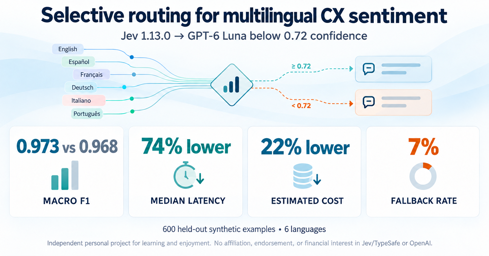

# Multilingual CX sentiment benchmark

[](https://github.com/dosorio79/jev_test/actions/workflows/ci.yml)
[](https://github.com/dosorio79/jev_test/actions/workflows/security.yml)
[](pyproject.toml)
[](LICENSE)

An offline-first BYOK (bring your own key) research toolkit for comparing multilingual financial customer-experience sentiment providers and selective routing. The fixed taxonomy is `negative=0`, `neutral=1`, and `positive=2` across Portuguese, English, Spanish, French, German, and Italian.

The dataset boundary uses Polars and Dataframely, so schema, nullability, uniqueness, categorical values, and the label/sentiment relationship are validated as dataframe operations. Pydantic is reserved for provider predictions and configuration.

Project code is MIT licensed; dataset redistribution rights are **unresolved**.
Read [dataset provenance and rights](docs/DATA_LICENSE.md) before redistributing
bundled data or publishing artifacts containing source text. This is a research
toolkit, with synthetic-data and historical-measurement limitations described below.
Repository visibility, report publication, and dataset redistribution are
separate release decisions.

## Final experiment result

[](docs/results/cx-sentiment-routing/index.html)

The frozen Jev 1.13.0 → GPT-6 Luna policy was evaluated once on the held-out
600-record synthetic test set. It accepted Jev predictions at maximum class
probability 0.72 and sent the remaining 42 records (7%) to GPT-6 Luna.

| Strategy | Macro F1 | P50 latency | P95 latency | Estimated USD / 1,000 |
| --- | ---: | ---: | ---: | ---: |
| Jev 1.13.0 | 0.966 | 229 ms | 281 ms | $0.01617 |
| GPT-6 Luna | 0.968 | 885 ms | 1,333 ms | $0.02273 |
| Jev 1.13.0 → GPT-6 Luna | **0.973** | **231 ms** | **1,073 ms** | **$0.01778** |

The hybrid met every predefined acceptance criterion. Its paired macro-F1
difference from GPT-6 Luna was +0.50 percentage points (95% bootstrap interval
−0.17 to +1.30 points), so the result supports the routing policy but does not
prove that it is universally better. Hybrid latency is derived from matched
fresh stage timings; fallback requests necessarily pay for both stages.

Read the [shareable final report](docs/results/cx-sentiment-routing/index.html)
for methods, language-level results, limitations, and interpretation. The next
useful investment is validation on privacy-reviewed, human-labeled real customer
feedback—not further optimization against this synthetic test set.

This is an independent personal project created for learning and enjoyment. I
am not affiliated with, employed by, endorsed by, or a shareholder of Jev,
TypeSafe, or OpenAI.

## Install and verify

Python 3.11 or 3.12 and [uv](https://docs.astral.sh/uv/) are required. Install the
[Quarto CLI](https://quarto.org/docs/get-started/) to generate HTML reports.

```bash
uv sync --frozen
uv run quarto check jupyter
uv run pytest
uv run ruff check .
uv run pyright
```

## Run an experiment

Edit [`experiments/mock.yaml`](experiments/mock.yaml), then run:

```bash
uv run cx-sentiment run experiments/mock.yaml
```

The supplied config uses `mock`, five records, and a new dated folder under `experiments/runs/`. It makes
no network calls and writes `predictions.jsonl`, `metrics.json`, `metrics.csv`, and
`report.html`. Mock accuracy is a pipeline test, not a model result.
Reports also include an editable `report.qmd` and `report_metadata.json`.
See [Learning Quarto](docs/REPORTING.md) for setup, a small example, and how to edit
and re-render saved reports without provider calls.

```yaml
provider: mock  # mock, openai, or jev
input: ../data/cx_sentiment_test_600.csv
output_dir: runs
limit: 5
```

Keep reusable configs in `experiments/` and their generated history in
`experiments/runs/`. Paths are relative to the YAML file. Unknown settings and nonpositive limits are
rejected. `limit` also caps provider requests. `output_dir` is the parent folder
for YAML runs; each invocation creates a child named with the UTC timestamp,
provider, and mode (`preview`, `live`, or `offline`). Previous runs are preserved.
Each child contains `experiment.yaml` with resolved paths and the run's results.
Only validated experiment settings are copied; credentials stay in the environment.
The command prints the report location when finished. Configuration errors name
the file and setting to fix.

For a paid provider, use the supplied smoke configurations described below.
Live YAML needs explicit cost caps chosen for your model and input:

```yaml
budget_usd: 0.05
cost_per_request_usd: 0.01
```

Preview with the same command; it writes `dry_run.json` without requiring credentials.
Paid execution is a separate opt-in: add `--live` to a paid-provider configuration
only after reviewing its record selection and cost caps. `mock` stays offline.

The CLI does not read credentials from YAML. OpenAI's model remains configured with
`OPENAI_MODEL`. Legacy flag-based commands still work, but cannot be mixed with YAML.

## How the code fits together

`cli.py` reads the experiment settings from `config.py` and loads the dataset through
`data.py`. `runner.py` checks the cache and budget, then calls the selected provider.
Each provider returns the same `Prediction` model. `metrics.py` scores those results;
`reporting.py` writes JSON/CSV and renders Quarto documents with Great Tables
and Plotly using Polars directly. `routing.py` compares cached decision and
fallback predictions to select a validation threshold without extra API calls.

## BYOK: preview first, then opt into paid calls

Two configs process the same first five validation records, with separate dated run
folders and a USD 0.05 budget per provider (USD 0.01 reserved per new request).
Use these for an initial pipeline check; five records cannot establish model quality.
On a fresh checkout, generate the ignored validation CSV from the bundled source
archive (the locked test CSV remains unchanged):

```bash
uv run cx-sentiment sample-validation \
  --archive data/raw/financial_sentiment_hf_v2.zip \
  --output-dir data
```

Preview both without credentials or provider network calls:

```bash
uv run cx-sentiment run experiments/openai-smoke.yaml
uv run cx-sentiment run experiments/jev-smoke.yaml
```

For paid execution, copy `.env.example` to the ignored `.env`, edit it locally,
and fill in only the provider credentials you intend to use. Set `OPENAI_MODEL`
explicitly to a model with a supported dated rate card; Jev defaults to
`jev-1.13.0`. Alternatively, supply variables through your shell's secret manager.
The application never loads `.env` implicitly, and YAML must contain no keys.
Only source a file you trust: this shell command executes its contents.

After reviewing the preview, explicitly export the variables and opt into the
paid provider you want to run (each command can incur charges):

```bash
set -a; . ./.env; set +a
uv run cx-sentiment run experiments/openai-smoke.yaml --live
uv run cx-sentiment run experiments/jev-smoke.yaml --live
```

The tested configuration uses `OPENAI_MODEL=gpt-5.4-mini` and `JEV_MODEL=jev-1.13.0`.
Model selection stays in the environment. Each command prints its report or preview
location under `experiments/runs/`. The configs use validation data,
preserving the locked test set for final evaluation.

To benchmark GPT-6 Luna alone on the same 600 validation records, override the
model after exporting your credentials:

```bash
OPENAI_MODEL=gpt-6-luna uv run cx-sentiment run experiments/luna-validation-full.yaml --live
```

This uses the existing prompt, cache, and budget guards. Compare its measured
quality, latency, and cost before choosing it for a hybrid policy.
The Luna YAML explicitly sets `reasoning_effort: none` for this classification
baseline. When set, reasoning effort is sent to OpenAI, recorded in the run YAML
and report metadata, and included in the prediction cache key. Omitting it keeps
the model's default behavior and existing cache identity.

A live run will have this layout (the timestamp is UTC):

```text
experiments/
  mock.yaml
  openai-smoke.yaml
  jev-smoke.yaml
  runs/
    2026-10-16T20-30-00.123456Z-openai-live/
      experiment.yaml
      predictions.jsonl
      execution.json
      metrics.json
      metrics.csv
      report_metadata.json
      report.qmd
      report.html
```

Preview folders contain `experiment.yaml` and `dry_run.json`. Archived YAML files
can be run again; their absolute paths preserve the input and output parent, and
replaying creates a new sibling run. Models continue to come from the environment;
successful reports record their actual model IDs in the run metadata.

## Audit and reproduce a run

Keep the resolved `experiment.yaml`, `report_metadata.json`, `execution.json`,
and predictions together. Metadata records the code/package version, selected
input fingerprint, requested and returned model identities, effective non-secret
settings, and dated pricing provenance. YAML alone does not restore model or
endpoint environment variables: reproduce those recorded settings explicitly,
use your own credentials, and retain the same source revision and lockfile.

`execution.json` distinguishes cached records, fresh attempts, failures, and
records skipped when execution stops. Its invocation accounting describes new
requests, known estimated USD spend, unknown-cost attempts, and budget
reservations for this invocation. A reservation is a guard, not a bill.
Prediction cost and latency describe the original request, including when a
prediction is reused from cache; summing historical prediction costs does not
measure new spend. A cache hit makes no new provider call. Missing costs remain
unknown, and the provider's bill remains authoritative.

Standard runs disable automatic retries. Budget stops and interruptions preserve
completed results and mark execution incomplete; normal comparison rejects
incomplete runs. Keep those artifacts for diagnosis and use the cache when
starting a new invocation. Do not edit an incomplete status into a completed run.
Legacy runs remain readable, with unavailable historical provenance labeled;
missing past measurements cannot be invented.

## Compare saved runs

Edit [`experiments/compare-smoke.yaml`](experiments/compare-smoke.yaml) to list
two or more saved run folders, then generate a combined report:

```bash
uv run cx-sentiment compare experiments/compare-smoke.yaml
```

This reads saved predictions without credentials or provider calls. It writes a
new dated `experiments/runs/*-comparison/` folder containing `comparison.yaml`,
`comparison.json`, `report.qmd`, and a standalone `report.html`. Source runs stay
unchanged. The supplied example references local smoke runs; run both provider
smoke experiments first and update the paths on a fresh checkout.

The report compares quality, coverage, request latency, token usage, USD estimates,
language results, and prediction disagreements. Runs must cover the same selected
source records and have exactly one prediction per sample ID; order may differ.
New runs save a selected-dataset fingerprint to detect changed inputs. Older runs
without fingerprints show an explicit warning: their historical input contents
cannot be verified. Five-record smoke results check the pipeline, not model quality.

See [comparison configuration and reports](docs/REPORTING.md#compare-saved-runs)
for the YAML format and re-rendering instructions.

## Optimize selective routing

The routing study reuses complete Jev and OpenAI validation runs. It aligns their
saved predictions, evaluates thresholds from 0.40 through 0.99, and writes an
offline quality–coverage–cost report without credentials or provider calls:

```bash
uv run cx-sentiment study experiments/routing-study.yaml
```

The report separates historical exploratory timing from offline simulations and
controlled measurements. Candidate thresholds are selected on validation data;
the locked test set remains untouched until one policy is frozen.

A live study YAML adds `sample_size`, `repetitions`, `concurrency`,
`routing_threshold`, `max_requests`, `budget_usd`, and
`cost_per_request_usd`. Run it without `--live` first to produce a zero-call
request and cost preview:

```bash
uv run cx-sentiment study experiments/my-live-routing-study.yaml
```

Do not add `--live` until the exact sample, repetitions, threshold, maximum
requests, and maximum USD budget have been reviewed and explicitly authorized.
The first authorized pilot is concurrency one; concurrency 5/10 and the locked
test set are separate gates. See [the performance-study protocol](docs/PERFORMANCE_STUDY.md).

## Metrics and how to read them

Quality and coverage run from 0 to 1; for example, `0.80` means 80%. Latency is
in milliseconds (`1,000 ms = 1 second`). Costs are estimates in USD.

| Metric | Meaning and interpretation |
| --- | --- |
| Support / records | Number of evaluated records, including failed predictions. Check this before comparing scores. |
| Accuracy | Fraction of all records classified correctly. Higher is better; unresolved predictions count as incorrect. |
| Precision | For a class, how often a prediction of that class is correct. Low precision means many false positives. |
| Recall | For a class, how many reference examples of that class were found. Low recall means many missed examples. |
| F1 / macro F1 | F1 balances precision and recall. Macro F1 averages the three class F1 scores equally, including classes absent from a small sample, whose F1 is zero. Higher is better. |
| Operational coverage | Fraction of records with a resolved label. A wrong label still counts as resolved; read coverage alongside accuracy. |
| P50 latency | The 50th percentile, or median: the middle of the recorded request times. Describes a typical request. Lower is faster. |
| P95 latency | The 95th percentile: approximately 95% of recorded request times are at or below it. Describes slower requests. Lower is faster. |
| USD total / known USD | Total estimated cost is available only when every prediction is priced. Known USD sums available estimates; a missing total is not zero cost. |
| USD per 1,000 | Total estimated cost divided by support, multiplied by 1,000. A normalized comparison, not a forecast or actual 1,000-request bill. |
| Priced fraction | Fraction of predictions with a cost estimate. Below 100%, total cost is incomplete; comparison charts show known costs as a lower bound. Unpriced runs have no cost point or bar. |
| Input / output tokens | Sums of recorded usage. Usage fraction measures records with at least one token count available; it does not guarantee both counts are present. |
| Reported credits | Provider-reported units, kept separate from USD estimates. |
| 95% bootstrap interval | Uncertainty estimated by resampling these records. Narrow intervals on tiny or repetitive samples do not establish generalization. |
| ECE / Brier score | Probability-quality measures; lower is better. Available only when every prediction provides class probabilities. Provider confidence alone is insufficient. |

For example, **P50 = 1,400 ms and P95 = 1,800 ms** means a typical recorded
request took about 1.4 seconds and the slower end was around 1.8 seconds. P95 is
not the maximum, a timeout, or a guarantee about future requests. Percentiles use
interpolation; with only five records, P95 is close to the slowest observation
and is a weak estimate of production tail latency.

Latency is measured per provider request, not for the entire experiment or HTML
render. Cached predictions retain their original latency and cost estimates;
reusing them does not incur that spend again. Historical failed calls may have
zero or missing latency, which can make low-coverage runs appear faster. New
runs retain available failure measurements; missing historical timing cannot be
reconstructed.

Read the report in this order:

1. **Check comparability:** same records, input verification status, model IDs,
   prompt versions, and whether a run is simulated. Legacy input warnings mean
   the original dataset contents cannot be verified.
2. **Check coverage and support:** failures must not disappear from the score;
   a five-record smoke run establishes pipeline behavior, not a model ranking.
3. **Inspect quality:** compare accuracy and macro F1, then per-language/class
   support and confusion matrices. Matrix rows are reference labels and columns
   are predicted labels; diagonal counts are correct. Unresolved predictions
   affect scores but sit outside the three displayed prediction columns.
4. **Inspect tradeoffs:** check pricing completeness and attempt scope before
   comparing costs. Partial-cost bars and points are lower bounds. Runs can share
   cached calls, so their totals are not additive new spend. Compare P95 as well
   as P50, and check whether rejected-attempt timing is missing.
5. **Read disagreements:** check which provider matches the reference label.
   Agreement can include shared mistakes and does not imply correctness.

For historical context, the first five-record live smoke readout on
**2026-10-16** was:

| Provider | Correct | Coverage | P50 | P95 | Estimated USD total |
| --- | --- | --- | --- | --- | --- |
| OpenAI (`gpt-5.4-mini`) | 5/5 | 100% | 1,394 ms | 1,752 ms | $0.000912 |
| Jev (`jev-1.13.0`) | 5/5 | 100% | 305 ms | 339 ms | $0.000081 |

Both produced reports without provider errors. Jev was faster and cheaper on
these five records; this sample does not establish a general quality or speed
advantage. Both runs predate dataset fingerprints and show historical-input
warnings in the comparison report.

## Validation sample

The source archive is available and its SHA256 matches the starter manifest. The generated validation sample is balanced at 600 records with no normalized exact cross-split overlap. Regenerate it with:

```bash
uv run cx-sentiment sample-validation \
  --archive data/raw/financial_sentiment_hf_v2.zip \
  --output-dir data
```

This creates a deterministic balanced `data/validation_600.csv` with seed `20261016` and a manifest containing the archive SHA256 and all selected source indices. It reads only `validation.csv` for the sample and checks normalized exact overlap against the archive's train and test splits. The locked test CSV is never rewritten.

## Provider configuration

Copy `.env.example` to `.env` and export it in your shell. The CLI does not load `.env` implicitly, which avoids surprising secret reads:

```bash
set -a; . ./.env; set +a
```

OpenAI uses the official Python SDK and Responses API structured output with one enum label. Scores and confidence remain null because the adapter does not invent probabilities. Set `OPENAI_MODEL` explicitly. Actual token usage is converted to a USD estimate using the model's dated rate card in `pricing.py`; no model prices are needed in `.env`.

The built-in standard short-context rate table, checked on 2026-10-15, covers `gpt-6-astra` ($10 input/$50 output), `gpt-6.1-sol` ($2/$10), and `gpt-6-luna` ($0.10/$0.50), all per million tokens. The source URL is stored with every rate card. Add a verified dated rate card in `pricing.py` before using another model or processing tier.

`gpt-5.4-mini` and its `gpt-5.4-mini-2026-03-17` snapshot are also supported at
$0.75 input/$4.50 output per million tokens, verified on 2026-10-16 against the
[official model page](https://developers.openai.com/api/docs/models/gpt-5.4-mini).

Jev uses TypeSafe's official `https://api.typesafe.ai/v1/systemone` endpoint and a typed `choice` question. The default model is pinned to `jev-1.13.0` so calibrated thresholds do not move with an alias. Its probability vector remains separate from provider confidence. TypeSafe lists Jev 1.13 and 1.14 at $0.042 per million input tokens with output tokens free; the dated table in `pricing.py` converts actual usage to USD. Override the URL or model only when the issuer of your key documents a different contract.

Live mode requires credentials, a positive record limit, a total USD budget, and a
per-request upper bound. Concurrency is one. Responses are resumable through the
content-addressed `.cache/cx_sentiment/` cache. Keys and full raw response bodies are
never logged or written to normal outputs.

## Jev probability precision and hybrid policy

Research checked against official TypeSafe sources on **2026-10-16**:

| Official source | What it establishes |
| --- | --- |
| [Choice](https://docs.typesafe.ai/primitives/choice) and [HTTP API](https://docs.typesafe.ai/api) | A probability is returned for each option, and the distribution is described as summing to 1. |
| [Python SDK answers and responses](https://docs.typesafe.ai/sdk/python/api/types/responses) | The Choice probability field is described as summing to approximately 1. |
| [Confidence](https://docs.typesafe.ai/confidence#choice) | Choice confidence is derived from the top probability and number of options; it is a different scale from maximum class probability. |

The reviewed sources do **not** specify a decimal precision, numerical acceptance
tolerance, or client normalization procedure. The Jev 1.13
[known-limitations page](https://docs.typesafe.ai/model-jaggedness/jev-1.13)
also supplies no probability-rounding policy. Consequently, treating our observed
discrepancy as rounding is a plausible explanation, not a confirmed guarantee.
The SDK's approximate-sum wording is important context when reviewing the strict
validator; it does not establish that every off-sum vector is acceptable.

In the full 600-record validation run, two otherwise schema-valid Jev responses
contained all three class probabilities with a total of **0.99**. Both selected
`neutral`, matching the references (one German record and one Portuguese record).
Our shared `Prediction` validator requires `abs(sum(probabilities) - 1) <= 0.0001`,
so the adapter recorded both as `invalid_response`. They remain unresolved in
the original benchmark: **574/600 correct, 99.67% operational coverage**. A correct
returned label does not make the complete response valid under the current rules.

This affects a hybrid policy because rejected Jev responses trigger OpenAI
fallback. Accepting a bounded discrepancy and normalizing it would instead let
the routing score decide. Normalization can also move scores across a threshold:
for example, a maximum of `0.60` in a vector totaling `0.99` becomes approximately
`0.6061` after dividing every probability by the total.

For three classes, TypeSafe's documented Choice-confidence formula simplifies
to `confidence = (3 * p_max - 1) / 2`. A top probability of `0.61` therefore maps
to a confidence of `0.415` under that formula. A threshold on `p_max` cannot be
copied unchanged to provider confidence. Preserve the returned confidence as its
own field, even if a future adapter normalizes the probability vector.

Our collection policy keeps the strict validator: **validation failures are improper
outputs and should be collected again**, within an explicitly authorized attempt
limit and budget. A valid but incorrect sentiment label is an ordinary scored
prediction, not grounds for recollection. Make one fresh attempt per rejected
record, preserve the original run, and record both attempts' costs in the derived
result. If that attempt is still improper, keep it unresolved for hybrid fallback.
Do not repeat requests indefinitely until a preferred output appears.

The normal runner currently reuses cached failures. Explicit recollection must
bypass those entries and use a new request identity to avoid replay through HTTP
idempotency. Valid recollected responses can replace failed cache entries; retain
the original failure and attempt audit in the new run. Cached successful responses
describe their latest attempt; the recollection report separately includes the
original rejected attempts' costs and usage.

On 2026-10-16, one fresh request for each of the two rejected records recovered
the Portuguese response; the German response again summed to 0.99. The derived
run therefore has **575/600 correct and 99.83% coverage**, after **$0.000032298**
of additional estimated spend. The original 574/600 result remains unchanged.
Original rejected-attempt latency was not saved, so the derived latency metrics
include only the fresh attempt for those records, not complete retry latency.

Before freezing a hybrid policy or changing score interpretation:

1. Record the strict validation rule, bounded recollection policy, routing signal,
   and threshold. No additional Jev-specific rounding tolerance is implemented;
   normalization is an optional future change, not required for recollection.
2. If normalization is introduced, first justify an explicit discrepancy bound.
   Keep it in the Jev adapter and the shared prediction contract strict.
   Require exactly the canonical classes, finite values in `[0, 1]`, a positive
   total, and an explicitly bounded discrepancy. Reject malformed distributions.
3. For a normalization change, test exact sums, accepted and rejected boundary
   cases, missing classes, negative/nonfinite values, and routing decisions close
   to the threshold.
4. Preserve original responses and runs. Reprocess available saved responses
   offline into a new, identified derived run with its interpretation recorded;
   ensure old error-cache entries do not bypass the new interpretation. Re-select
   thresholds on validation data before final testing. New paid calls are not
   needed just to reinterpret the retained responses.

The historical error path omitted usage and elapsed request time from the
normal failed-prediction record. New runs retain available measurements even
when score validation fails; older results keep their original limitations. The saved raw responses allowed
a separate usage audit to supplement Jev's known cost from **$0.00968058** to
**$0.009712878** for this run; the original report still marks total cost incomplete.
Unrecorded historical latency cannot be recovered from token usage or invented.
Recollection does not normalize scores or alter the original benchmark. It
creates a separate result; the normal runner has no automatic recollection loop.

## Scientific boundary

Threshold selection belongs exclusively on the generated validation set. Cache both providers' validation predictions once, then simulate thresholds from cached results. Freeze the prompt version, model IDs, routing signal, and chosen threshold before the one-time test evaluation. See [METHODS.md](docs/METHODS.md) for the protocol and limitations.

The validation-selected policy is recorded in
`experiments/frozen-routing-policy.yaml`: Jev 1.13.0 first, using maximum class
probability at threshold 0.72, with GPT-6 Luna as fallback. The file also pins
the prompt versions and locked-test hash. Its one-time final evaluation is now
complete; the file records that status and links to the curated aggregate report.
Do not retune the policy from the held-out results.

After live validation prediction files exist, select and persist the policy without making new API calls:

```bash
uv run cx-sentiment select-threshold \
  --input data/validation_600.csv \
  --decision-predictions outputs/jev-validation/predictions.jsonl \
  --fallback-predictions outputs/openai-validation/predictions.jsonl \
  --output outputs/validation-selection.json --max-f1-degradation 0.02
```

Regenerate a report from any cached prediction file:

```bash
uv run cx-sentiment report --input data/validation_600.csv \
  --predictions outputs/jev-validation/predictions.jsonl \
  --output-dir outputs/jev-validation-report
```

## Contributing and security

See [CONTRIBUTING.md](CONTRIBUTING.md) for local checks and the `dev` to `main`
release workflow. Report vulnerabilities privately using [SECURITY.md](SECURITY.md).
Workflow badges show the last GitHub result; passing scans do not guarantee security.
